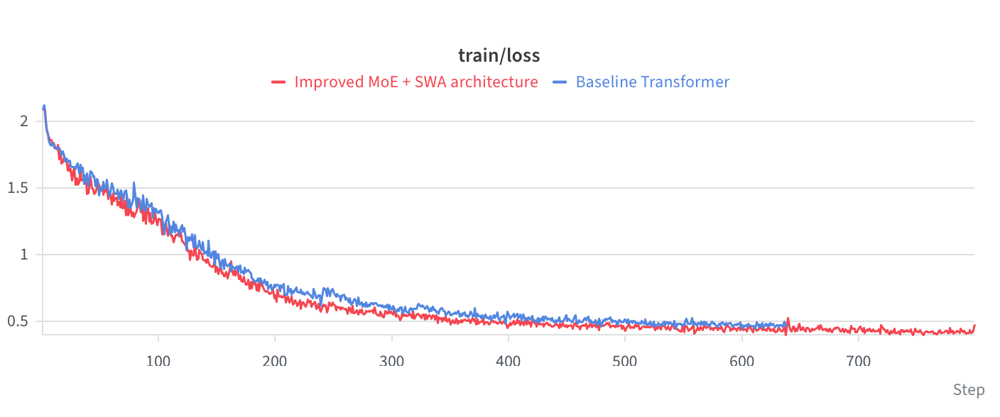
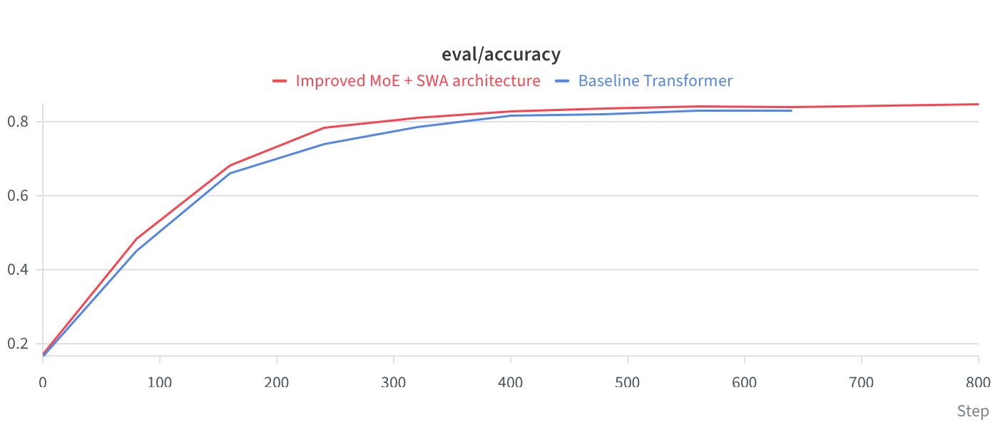

# Implementation of the GPT-OSS-20B Architecture: From Theory to Production


-lightgrey.svg)


## 1. Abstract & Objective

This project is a fully functional, scalable PyTorch implementation of the decoder-only **GPT-OSS-20B** architecture. The primary objective is to bridge the gap between academic concepts of modern Large Language Models (LLMs) and a production-ready pipeline.

Instead of static text datasets, the pipeline uses dynamically generated stochastic sequences (via the `SeqGen` process). This allows for the isolated testing of the autoregressive capabilities of the Attention mechanism when handling complex probabilistic transitions. The architecture is optimized for maximum memory and computational efficiency through advanced techniques such as RoPE, GQA, Sliding Window Attention, and Mixture of Experts.

## 2. Architecture & Mathematical Formulation

The model consists of several key modules designed to solve the quadratic complexity of the classic transformer and improve its extrapolation properties:

### 2.1 Rotary Positional Embeddings (Pairwise RoPE)

Instead of absolute positional embeddings, the Rotary Positional Embeddings mechanism is applied, which encodes the relative position of tokens by rotating the query ($Q$) and key ($K$) vectors. For each pair of dimensions, frequencies $\theta$ are calculated:

$$
\theta_i = \text{base}^{-\frac{2i}{d}}
$$

A pairwise rotation of the tensor elements $(x_{2i}, x_{2i+1})$ is applied using precomputed sine and cosine values, which keeps the dot product dependent only on the relative distance between tokens.

### 2.2 Grouped Query Attention (GQA) & Sliding Window

To reduce the memory bandwidth bottleneck during inference, **GQA** is applied, where multiple query heads share the same key and value heads.

To reduce computational complexity from $O(N^2)$ to $O(N \times k)$, **Sliding Window Attention (SWA)** is applied on alternating layers. The causal attention mask is modified into a band matrix, limiting the token's field of view to a window of size $k$:

$$
M_{ij} = \begin{cases} 0 & \text{if } i \geq j \text{ and } i - j \leq k \\ -\infty & \text{otherwise} \end{cases}
$$

### 2.3 Mixture of Experts (MoE) Routing

The classic dense feed-forward network (Dense FFN) is replaced by a Sparse MoE layer. The layer contains $E$ independent `SwiGLU` subnetworks. The routing vector calculates activation probabilities and selects the $Top\text{-}K$ experts for each token:

$$
\text{Weights} = \text{Softmax}(\text{TopK}(x W_{\text{router}}))
$$

This allows the model's capacity to be exponentially increased without increasing FLOPs during inference. The loss function is computed as standard cross-entropy across all batches: $\mathcal{L}_{\text{CE}} = - \frac{1}{N} \sum y_i \log(\hat{y}_i)$.

## 3. Visualizations

The architecture's training is tracked in Weights & Biases. The charts below demonstrate the stable convergence of the loss function and the growth of validation metrics when using the hybrid architecture.




*Figure 1: Training dynamics on Apple Silicon (MPS). The **blue line** represents the Baseline Transformer (8 epochs). The **red line** demonstrates the improved MoE + SWA architecture (10 epochs), achieving lower loss and higher final accuracy.*

## 4. Evaluation Metrics & Results

Pipeline performance was evaluated using the Per-Token Accuracy metric on a test set of 1000 sequences. Training on Apple Silicon (MPS) yielded the following results:

| Architecture | Attention Windows | Epochs (Steps) | Accuracy (Eval Acc) | Loss (Train) |
| :--- | :--- | :--- | :--- |:-------------|
| **Base Transformer (MHA)** | Full Causal | 8 (~600 steps) | ~83.09% | ~0.4900      |
| **GQA + MoE + SWA** | Alternating SWA | 10 (~750 steps) | **~84.89%** | **~0.4755**  |

### Inference Strategy Analysis

Two autoregressive decoding strategies were tested during inference:

*   **Greedy Decoding:** Selecting the token with $\max(p)$ leads to rapid context degradation and sequence looping (e.g., `[2, 2, 2...]`).
*   **Nucleus Sampling (Top-p) + Temperature:** Using probabilistic sampling with tail truncation ($Top\text{-}P = 0.5$) and temperature scaling ($t = 1.5$) smoothed the Softmax distribution. This resolved the looping issue and provided diverse, stable generation.

## 5. Quick Start

The project uses `uv` for ultra-fast dependency and virtual environment management. All routine processes are encapsulated within the `Makefile`.

```bash
# Clone the repository and install dependencies
git clone https://github.com/Pavelpuff/gpt-oss-20b-core.git
cd gpt-oss-20b-core
make setup

# Start the training loop (with W&B logging)
make train

# Run inference (token generation via Nucleus Sampling)
make evaluate
```